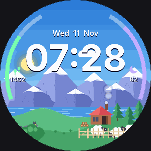

# Aurora Farm: an animated Wear OS watch face



A small story that plays on a 45-second day/night loop, built for my Galaxy Watch4 Classic.
Full-length demo video: [media/demo.mp4](media/demo.mp4)

## What it does

**Day**
- A boy walks out of his cabin, chops a tree, fills a sack with logs, stacks them on the woodpile and goes back inside.
- The sun crosses the sky and clouds drift past.

**Night**
- Aurora, twinkling stars and a passing rocket.
- A sheep opens the fence gate and wanders out to graze. A wolf hiding behind a bush growls, creeps out, pounces and runs off with it.

**All the time**
- Chimney smoke that grows as it rises, and flowing lake water.
- Sheep inside the fence shuffle about and graze.

**Real data**
- Time and date.
- Step arc (left) that fills toward your daily step goal, with your step count.
- Sleep arc (right): set it to *Samsung Health → Sleep* in Customise.
- Fireworks once you reach your step goal.
- Below 20% battery the smoke thins and the cabin lights dim.

**Tap**
- Tap a sheep in the fence: "Baa!"
- Tap the cabin: the windows flicker.

The always-on display shows just the time and date on black, so the animations don't use battery.

## How it was made

Built with Claude (Opus, in the Claude app), one feature at a time from a chat conversation. Claude:
- drew all the scenery and characters as images with Python (Pillow)
- wrote the face in Google's [Watch Face Format](https://developer.android.com/training/wearables/wff) (XML only, no app code), checked against Google's published spec files
- packaged and signed the APK with the Android build tools
- read the watch's error logs to fix problems during testing

## Install (free)

You need a computer with [Android platform-tools](https://developer.android.com/tools/releases/platform-tools) (adb).

1. On the watch: **Settings → About watch → Software information**, tap **Software version** about 7 times to enable Developer options.
2. **Settings → Developer options**: turn on **ADB debugging** and **Wireless debugging**. Watch and computer must be on the same Wi-Fi.
3. Pair and connect (use the numbers shown on your watch):
   ```
   adb pair <pairing-ip:port>        (enter the 6-digit code)
   adb connect <ip:port>
   ```
4. Install:
   ```
   adb install AuroraFarm-v7.apk
   ```
5. On the watch: long-press the watch face, tap **+**, find **Aurora Farm** under Downloaded.
6. Turn Wireless debugging off again afterwards (it uses battery).

**Compatibility:** tested only on a Galaxy Watch4 Classic (SM-R895F). It uses Watch Face Format version 2, so other Wear OS watches that support WFF v2 should work, but I haven't checked them.

## Source

`source/` contains everything that goes into the APK: `AndroidManifest.xml`, `res/raw/watchface.xml` (the whole face) and the images in `res/drawable-nodpi/`.

## License

MIT, see [LICENSE](LICENSE).
